# BoxBox Replay

**Replay any Formula 1 race on a pit-wall timing screen — every driver on track, gaps counting down, and an engineer you can ask about any corner.**

Free, no account, no live-timing subscription. Data comes from public archives and is cached locally, so a race you have opened once works offline from your own machine.

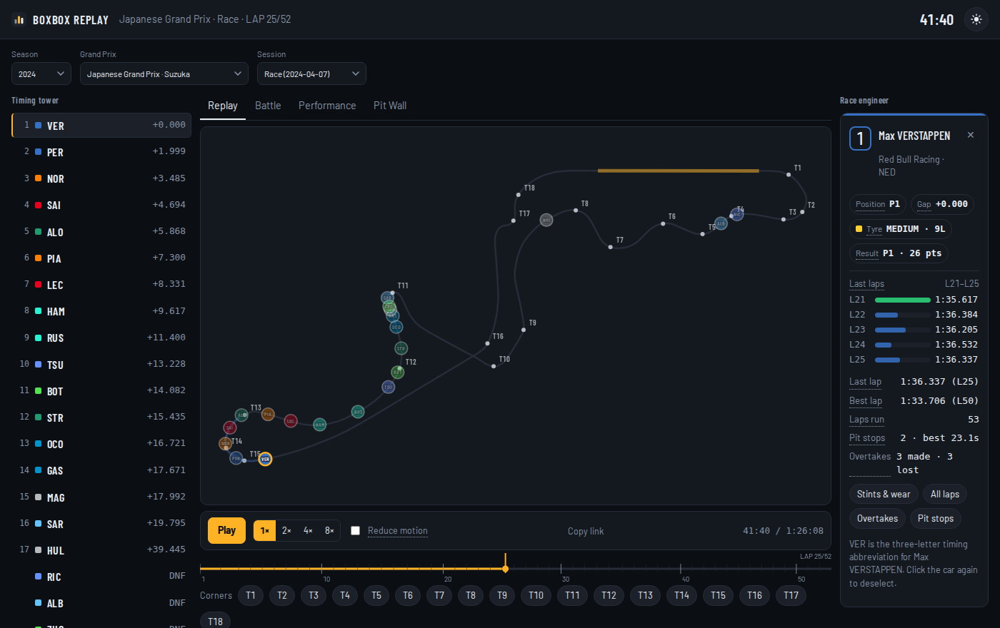

<sub>Suzuka 2024, lap 25. Timing tower on the left, circuit and playback in the middle, driver card and engineer on the right.</sub>

## What it does

- **Dashboard with continue-list.** No forced session: a landing page shows the sessions you opened recently (stored on this device, filterable, removable one by one or cleared), a random “Surprise me” picker, and how the app works.
- **Full-field replay.** All 20+ cars on the circuit at once, moving on the real session clock (lights out to chequered flag). Play, pause, 1×–8×, scrub, or press Space.
- **Timing tower.** Classification order with live gaps, position numbers, and retired cars marked DNF/OUT instead of showing a stale gap.
- **Track map.** Circuit drawn from the session's own telemetry, with corners detected from curvature and DRS zones read from the cars' DRS state.
- **Battle view.** A live **Battles now** strip lists neighbouring drivers within 1 s at the current frame (click to compare), plus an anchor and up to two challengers: relative gap over the whole session, lap-by-lap pace deltas, pairwise head-to-head, and the overtakes between them.
- **Performance.** Stint timeline with pit-stop notches (hover for compound, tyre age and the gap at the stint start), wear per stint grouped by driver, lap-time evolution, weather over the race, team radio (audio links), and the full race-control log with search and filters.
- **Driver drill-down.** Click any car or tower row for position, gap, tyre age, result, a five-lap strip, pit stops, overtakes — each opening a full view.
- **Lap times.** Sortable by time or sector (fastest first), filterable by driver, and comparable across any number of drivers.
- **Qualifying mini-sectors (v3).** Real segment strips (green/purple/yellow) for qualifying and practice, with placeholder detection; races show nothing rather than fake segments.
- **Pit crews & overtakes (v3).** Stop-time distribution, median/best, outlier flags and the most overtakes, from the cached feeds.
- **Telemetry lab (v3).** Up to three drivers on the same clock: speed traces, throttle/brake/gear/DRS at the cursor, and explicit nulls when a channel is missing. Distance-aligned lap comparison stays in Lap duel.
- **Driver inputs.** Throttle, brake, gear and DRS for the lap under the playhead, overlaid for every followed driver, with a hover readout at any point on the trace; missing channels print "—" instead of a guess.
- **Lap duel.** Two laps race the same circuit, aligned by distance around the lap, with a live delta that starts at 0.000 and closes exactly on the official lap-time difference.
- **Strategy model (v3).** A transparent stay-vs-pit model over clean laps, stints and measured pit-lane times: ranked options, break-even pit loss, an undercut estimate, coverage/exclusions and every assumption. The v2 toy remains in Pit Wall for comparison.
- **Pit strategy toy model.** "Pit now or stay out?" using measured pace and wear, with the arithmetic shown step by step, a **break-even pit loss**, the assumptions, and an **Explain this call** button that names exactly what the engineer receives and will not recalculate.
- **Ask the race engineer (chat).** A bordered chat panel with a pinned composer and two-sided bubbles (you on the right, the engineer on the left): follow-ups keep the thread, prompt chips stay one click away, the transcript scrolls (with a “Newest” jump when you read back), long questions wrap, and Clear chat wipes the tab-local history. It adapts to the session — race prompts and a race recap for races, pole/gap prompts and a qualifying recap for qualifying, fastest-lap/team prompts for practice. Answers use full driver names and every session fact (full classification, retirements, sector and ideal-lap references, pace, pit stops, tyre plans, overtakes, weather, race control), stay in the app's voice, and decline off-topic questions. The API key stays on the server.
- **Shareable moments.** "Copy link" stores the exact timestamp, so a link reopens the same frame.
- **Layouts and offline (v3).** Full / Focus / Data layouts; **Save offline** caches the current session (max 25 MB) and the installed PWA replays it with the network off. AI is disabled offline and says so.
- **Weather & race-control timeline (v3).** VSC/SC bands, flag markers and the track-temperature trace on one session clock, with counts and hover detail; descriptive only.
- **Data export.** Laps and stints as CSV, generated client-side from the loaded session; no new requests, no secrets.
- **Share card.** One click downloads a 1200×630 PNG of the current frame — circuit, every car, lap and clock — for a post or a message.
- **Dark and light themes**, keyboard shortcuts, reduced-motion support, and a layout that stacks on phones.

| Battle | Performance |
|---|---|
| 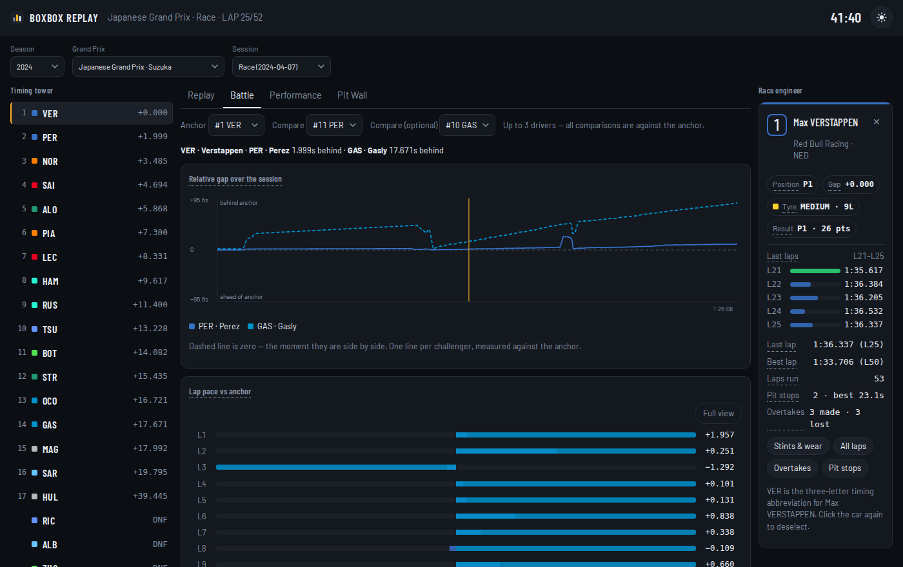 | 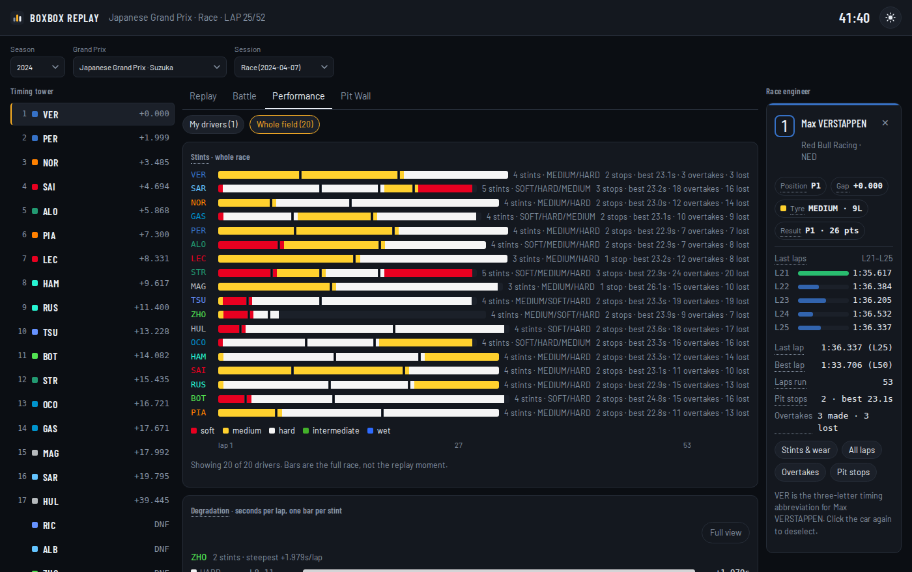 |

| Pit wall | Lap times (full view) |
|---|---|
| 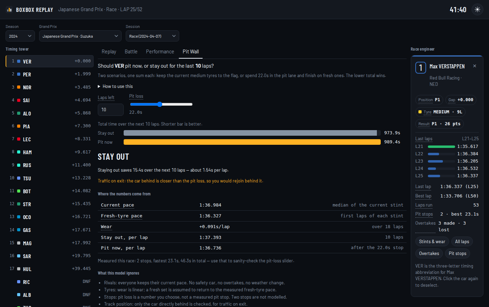 | 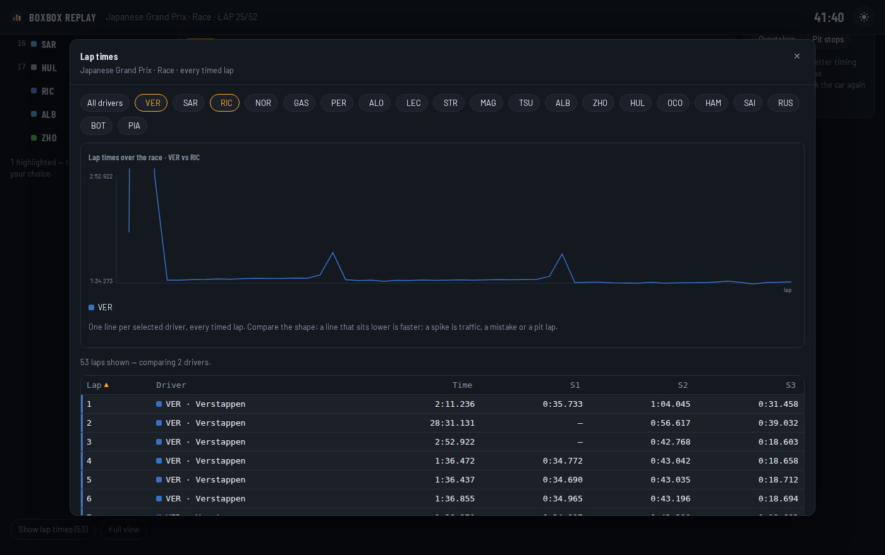 |

| Lap duel | Driver inputs |
|---|---|
| 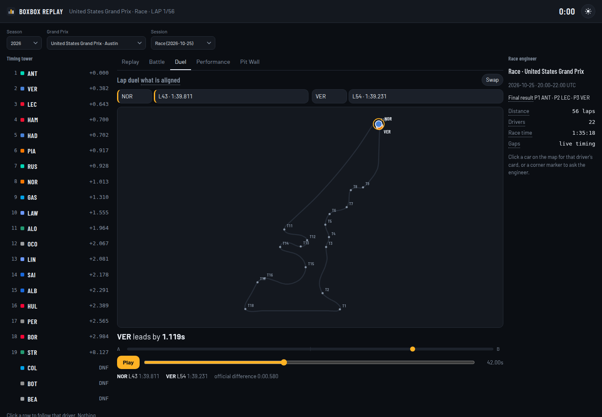 | 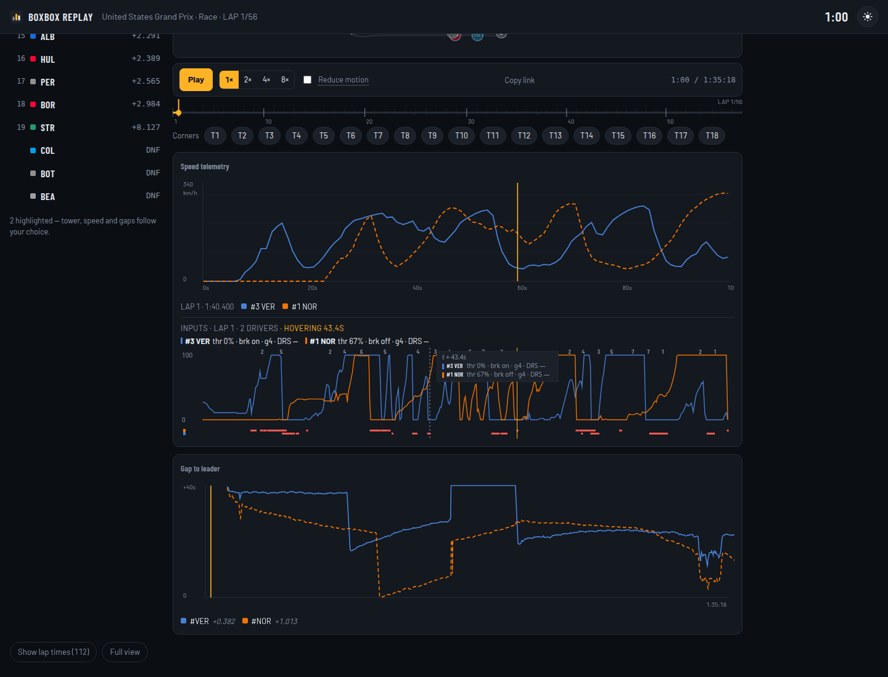 |

| Ask the race engineer | Dashboard |
|---|---|
| 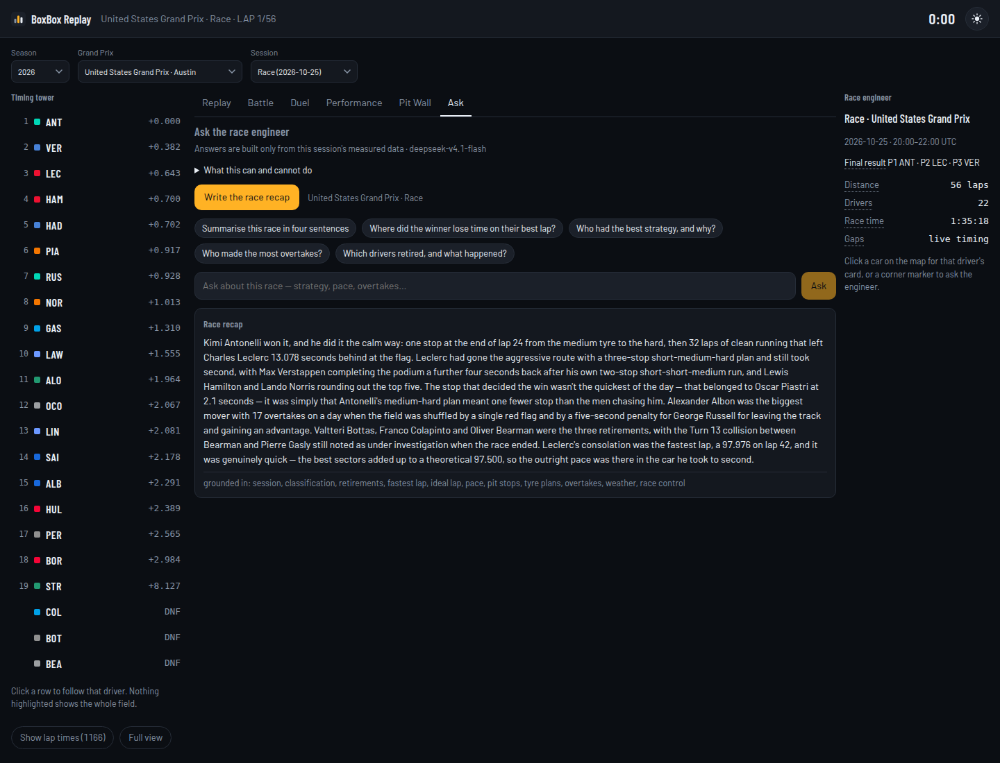 | 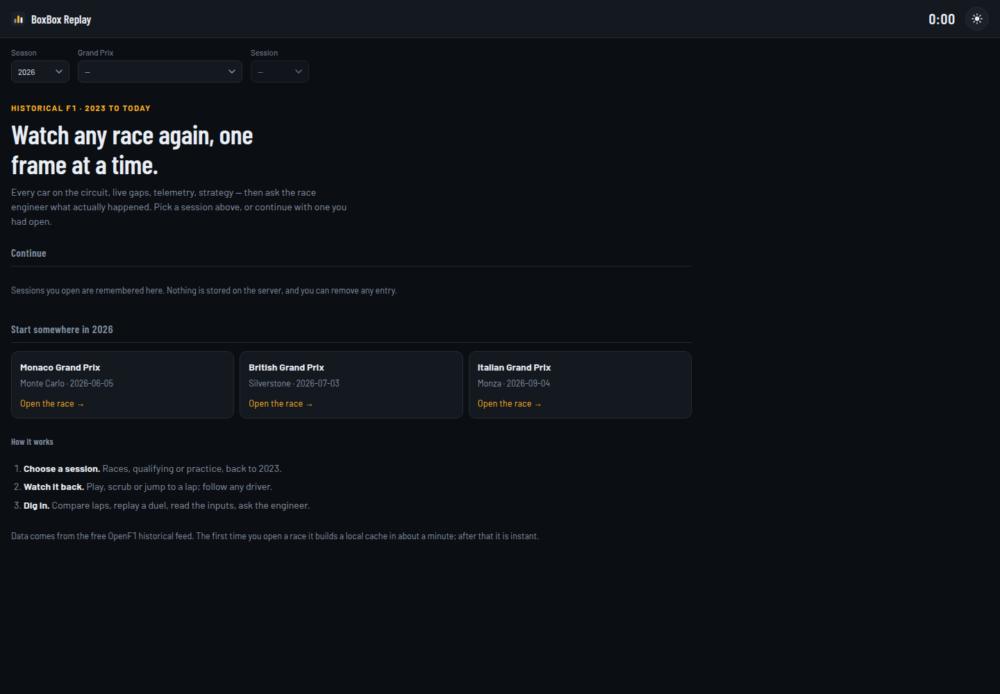 |

| Light theme | |
|---|---|
| 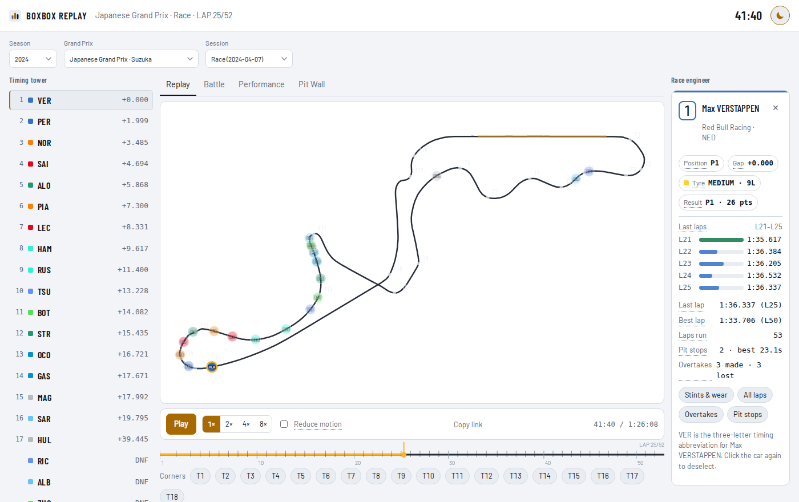 | |

| Phone | |
|---|---|
| 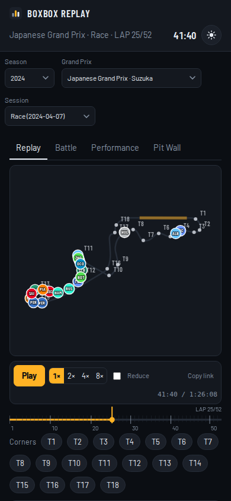 | |

## Architecture

```
                 browser (React SPA, TypeScript, hand-drawn canvas)
                ┌───────────────────────────────────────────────────┐
                │ map · timeline · charts · chat · pit wall         │
                └───────────────▲───────────────────────────────────┘
                                │  JSON over /api (same origin)
                ┌───────────────┴───────────────────────────────────┐
                │ nginx (serves the built SPA, proxies /api)        │
                └───────────────▲───────────────────────────────────┘
                                │
                ┌───────────────┴───────────────────────────────────┐
                │ FastAPI (api/main.py)                             │
                │  serialises DataFrames → JSON, clamps windows,    │
                │  session/chat/pit endpoints, session-aware facts  │
                └───────┬───────────────────────────────┬───────────┘
                        │                               │
        ┌───────────────┴──────────────┐   ┌────────────┴─────────────┐
        │ analysis.py (pure functions) │   │ ai.py · coach.py         │
        │ corners, deltas, wear, model │   │ grounded AI answers;     │
        │                              │   │ corner coach + fallback  │
        └───────────────▲──────────────┘   └────────────┬─────────────┘
                        │                               │
                ┌───────┴───────────────────────────────▼───────────┐
                │ data_loader.py · ratelimit.py                     │
                │ 3/s + 30/min bucket · retry · session clamp       │
                │ parquet cache in ./data/cache                     │
                └───────▲───────────────────────────────▲───────────┘
                        │                               │
                ┌───────┴────────┐              ┌───────┴────────────┐
                │ OpenF1         │              │ OpenCode Go (AI)   │
                │ sessions, laps │              │ optional, keyed    │
                │ location, car… │              │ chat/recap/pit     │
                └────────────────┘              └────────────────────┘
```

**How a replay is built.** Selecting a session triggers three stages: the lap
clock (so the timeline, `LAP x/y` and gaps work immediately), the circuit
geometry from one representative lap, then positions for every driver (streamed
in, so cars appear progressively). Car telemetry for the drivers you follow is
fetched on demand. Everything is cached as parquet keyed by session, so the
first visit to a race takes about a minute and every visit after that is instant.

**Playback model.** One shared store owns the clock. The map, timeline and charts
subscribe to it directly and redraw on the animation frame; the heavier page
around them re-renders at ~8 Hz, which keeps playback at 60 fps.

**Honesty rules baked into the code.** Numbers come from the feeds or are
computed from them; when a feed is missing the UI says so and hides the block
rather than inventing a value. Retired cars are classified last. The tower is
ordered by classification gap (what a timing screen shows), not by physical
track order. The pit model prints its inputs and its assumptions.

**How a visit works.** The landing dashboard offers your recently opened
sessions and a random picker; choosing one loads the replay, tower and panels.
A session can be a race, qualifying or practice, and the Ask tab adapts its
prompts, recap and facts to that session type. AI features are optional: without
`OPENCODE_API_KEY` the chat and pit explanation say they are disabled; every
other panel still works.

**Credentials.** OpenF1 needs no account or key. The only optional credential is
`OPENCODE_API_KEY` (OpenCode Go) for the AI answers; it stays on the server and
in `.env`. See [`.env.example`](.env.example).

More detail: [`docs/ARCHITECTURE.md`](docs/ARCHITECTURE.md) · UI decisions in
[`docs/UI_REDESIGN_V2.md`](docs/UI_REDESIGN_V2.md) · data-source research in
[`docs/UI_RESEARCH.md`](docs/UI_RESEARCH.md).

## Run it

### Docker (recommended)

```bash
cp .env.example .env          # optional: defaults work without it
./scripts/setup.sh            # builds api + web, serves http://localhost:8501
./scripts/setup.sh --prod     # production stack (asks for confirmation)
```

The stack is two containers: `api` (FastAPI, internal port 8000) and `web`
(nginx serving the SPA and proxying `/api`). The dev override hot-reloads the API
and bind-mounts the source; the prod override adds restart policies, resource
limits and `no-new-privileges`.

### Local development

```bash
python3 -m venv .venv && .venv/bin/pip install -r requirements.txt
.venv/bin/uvicorn api.main:app --reload --port 8000     # API

cd web && npm install && npm run dev                    # SPA on :5173, proxies /api
```

## Configuration

| Variable | Default | Purpose |
|---|---|---|
| `APP_ENV` | `development` | `development`, `staging` or `production`; unknown values are treated as production for safety |
| `APP_PORT` | `8501` | Host port for the web container |
| `OPENF1_BASE_URL` | `https://api.openf1.org/v1` | Data feed base URL |
| `OPENF1_API_KEY` | empty | Only needed if the feed starts requiring credentials; sent as Bearer and `api_key` |
| `OPENF1_RATE_PER_SEC` | `3` | Request budget, part 1. Raise to `6` only on the sponsor tier |
| `OPENF1_RATE_PER_MIN` | `30` | Request budget, part 2: rolling 60 s window |
| `OPENCODE_BASE_URL` | `https://opencode.ai/inference/go/openai/v1` | OpenAI-compatible AI endpoint (OpenCode Go) |
| `OPENCODE_API_KEY` | empty | AI key; server-only, never exposed to the browser |
| `OPENCODE_MODEL` | `deepseek-v4.1-flash` | Model id used for answers |
| `AI_MAX_TOKENS` | `1200` | Answer budget (reasoning tokens count) |
| `AI_RATE_PER_MIN` | `6` | Server-side AI budget |
| `CACHE_DIR` | `data/cache` | Where parquet caches live |

Every variable is documented with a placeholder in [`.env.example`](.env.example).
`.env` is gitignored; never commit real values.

## API

| Endpoint | Returns |
|---|---|
| `GET /years` | Seasons with data |
| `GET /meetings?year=` | Grands Prix for a season |
| `GET /sessions?year=&meeting_key=` | Sessions for a meeting |
| `GET /sessions/status?keys=` | Telemetry availability per session |
| `GET /drivers?session_key=` | Entry list |
| `GET /session/info` | Session clock, race distance, entry count |
| `GET /session/geometry` | Circuit outline, corners, DRS zones, rotation |
| `GET /session/replay` | Every driver's positions, sampled; lap markers |
| `GET /session/gaps` | Gaps to leader (live intervals, else derived from lap times) |
| `GET /session/speed?driver_number=` | One driver's speed for the session |
| `GET /session/duel?a_driver=&a_lap=&b_driver=&b_lap=` | Two laps aligned by distance: traces plus the time delta at equal progress |
| `GET /session/inputs?t0=&t1=` | Throttle, brake, gear and DRS over a session-time window |
| `GET /ai/status` | Whether AI is configured and which model is used |
| `POST /ai/chat` | Multi-turn grounded chat (bounded history) |
| `POST /ai/recap` | Session recap in the session's own terms |
| `POST /ai/pit` | Explains a computed pit call; never recalculates it |
| `GET /session/pit` · `/overtakes` · `/result` · `/positions` | Stops, passes, classification, official order |
| `GET /laps`, `/stints`, `/weather`, `/radio`, `/race-control` | Session feeds |
| `POST /corner-loss` | Measured time lost at a corner vs a reference lap |
| `POST /coach/ask` | Grounded engineer answer (or an honest "unavailable") |
| `POST /pit-call` | Toy pit-strategy comparison |

`GET /api/healthz` is the health probe. Full shapes are in
[`docs/ARCHITECTURE.md`](docs/ARCHITECTURE.md#api).

## Quality gates

```bash
pytest                       # 79 Python tests, all HTTP mocked
ruff check .                 # lint
cd web && npm test           # 65 frontend tests (vitest)
cd web && npm run build      # tsc type check + bundle
docker compose build         # image build
```

CI runs both stacks on every push — `ruff`, `pytest`, `npm test`, `tsc`, `oxlint`
and `vite build` — plus a secret scan (gitleaks), dependency audits (`pip-audit`,
`npm audit`) and an advisory container scan (Trivy). See
`.github/workflows/ci.yml`. Containers run as a non-root user with
`no-new-privileges` in production.

## Project layout

```
api/main.py          FastAPI: endpoints, JSON serialisation, AI facts
data_loader.py       OpenF1 client: fetch, retry, clamp, parquet cache
ratelimit.py         Sliding-window request budget (3/s + 30/min)
analysis.py          Pure math: corners, deltas, wear, positions, pit model, duels
ai.py                OpenCode Go client: chat, recap, pit explainer, scope guard
coach.py             Corner-coach prompt + measured fallback
web/src/             React SPA: api client, playback store, canvas map,
                     charts, chat, dashboard, panels, modals
tests/               pytest suites (pure maths, API contracts, cache, AI)
docs/                Architecture, deployment, testing, design notes, screenshots
scripts/setup.sh     One-command dev/prod stack
Dockerfile           API image (non-root, healthcheck)
web/Dockerfile       Multi-stage SPA build → nginx
compose*.yaml        base / dev override / prod override
```

## Data sources and limits

- **[OpenF1](https://openf1.org)** — sessions, laps, positions, car telemetry,
  intervals, stints, weather, radio, race control, pit stops, overtakes,
  results. Anonymous access is rate-limited; this app enforces both documented
  limits (3 req/s and 30 req/min) with one bucket, single-flights concurrent
  builds, and caches every response to disk.
- **[OpenCode Go](https://opencode.ai/docs/go/)** — optional AI answers in the
  Ask tab and pit-wall explainer (a paid subscription; the key stays server-side).

Known limitations, stated plainly:

- **First open of a race takes ~1 minute** (dozens of telemetry requests), then
  it is served from cache. Popular sessions can be pre-warmed by opening them.
- **AI quota.** OpenCode Go has a monthly allowance; when it runs out the AI returns a clear "usage limit reached" message (HTTP 429) and every non-AI panel keeps working.
- **OpenF1 availability.** If the feed rate-limits or blocks a client, uncached
  sessions show a clear message and cached ones keep working. If it begins
  requiring credentials, set `OPENF1_API_KEY`.
- **Corners are detected**, not official: labels T1…Tn come from curvature, so
  they are indicative rather than FIA numbering.
- **The pit model is a toy**, and says so: linear wear, static rivals, a pit
  loss you choose.
- **No live timing.** Historical sessions only (a day behind at the earliest),
  because OpenF1's live window is paid.

This project is not affiliated with Formula 1, the FIA or any team. OpenF1 is an
unofficial community API.

## Contributing

Issues and pull requests are welcome. Please run the quality gates above before
opening a PR, keep commits focused, and follow the honesty rule: never fabricate
a number the feeds do not provide — show an empty state instead.

## License

[MIT](LICENSE) © 2026 Kelana Chandra Helyandika — use it, fork it, learn from it.
Data belongs to its sources; see the credits above.
